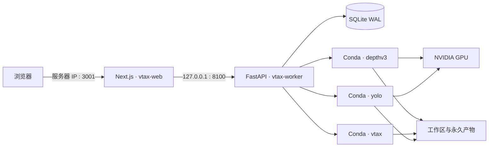

# VTAX 单机 Ubuntu 部署指南

本文只描述一种部署方式：**单台 Ubuntu 22.04 LTS + NVIDIA GPU + systemd**。

部署完成后：

- Next.js 前端监听 `0.0.0.0:3001`；
- FastAPI 编排服务监听 `127.0.0.1:8100`；
- 视频清洗、预标注和 YOLO 训练分别运行在独立 Conda 环境；
- 浏览器通过 `http://<服务器IP>:3001` 访问系统。

> [!IMPORTANT]
> 当前版本没有账号和权限系统。若服务器不在可信网络中，请在前端增加带身份认证和 TLS 的反向代理，不要直接将 3001 端口暴露到公网。

## 1. 部署架构



| 服务 | 地址 | 说明 |
| --- | --- | --- |
| `vtax-web` | `0.0.0.0:3001` | 浏览器入口 |
| `vtax-worker` | `127.0.0.1:8100` | 编排 API，仅供本机前端访问 |
| Ollama（可选） | `127.0.0.1:11434` | 本地视觉大模型 API |

## 2. 硬件和系统要求

### 推荐配置

- Ubuntu Server/Desktop 22.04 LTS，x86_64；
- NVIDIA GPU，推荐 12 GB 以上显存；默认训练参数针对 16 GB 显存；
- 32 GB 以上内存；
- 系统盘至少 100 GB 可用空间，正式项目建议单独准备高速数据盘；
- 可访问 DashScope API，或本机可运行 Ollama。

### 已验证的软件基线

| 组件 | 已验证版本 |
| --- | --- |
| Ubuntu | 22.04 LTS |
| Node.js | 22 LTS |
| Python | 3.10 |
| Conda | 25.x |
| PyTorch | CUDA 版本，验证环境为 `2.9.1+cu128` |
| Ultralytics | 使用项目指定的 YOLO26 源码，验证版本 `8.4.47` |

Node.js 主版本必须为 22。`depthv3` 和 `yolo` 环境中的 `torch.cuda.is_available()` 必须返回 `True`。

## 3. 安装系统依赖

以具备 `sudo` 权限的用户执行：

```bash
sudo apt update
sudo apt install -y \
  git curl ca-certificates build-essential \
  ffmpeg libgl1 libglib2.0-0
```

### 安装 NVIDIA 驱动

推荐使用 Ubuntu 提供的驱动工具：

```bash
sudo ubuntu-drivers autoinstall
sudo reboot
```

重启后验证：

```bash
nvidia-smi
```

### 安装 Node.js 22 LTS

```bash
curl -fsSL https://deb.nodesource.com/setup_22.x | sudo -E bash -
sudo apt install -y nodejs

node --version
npm --version
```

`node --version` 应输出 `v22.x.x`。

### 安装 Miniconda

当前 systemd 模板使用 `/root/miniconda3`，因此建议以 root 安装：

```bash
sudo -i
curl -fsSLo /tmp/miniconda.sh \
  https://repo.anaconda.com/miniconda/Miniconda3-latest-Linux-x86_64.sh
bash /tmp/miniconda.sh -b -p /root/miniconda3
/root/miniconda3/bin/conda --version
```

后续命令默认在 root shell 中执行。若需要部署为普通用户，必须同步修改环境路径、目录权限和两个 systemd 服务文件。

## 4. 准备目录与代码

推荐目录结构：

```text
/root/WWB/
├── VTAX/
│   ├── Data_Annotation_Agent/   # 本仓库
│   ├── frame_cluster_filter/    # 视频清洗模块
│   ├── models/
│   ├── workspaces/
│   ├── LabeledDataset/
│   ├── Weight/
│   ├── ONNX/
│   └── var/
└── yolo26/
    └── ultralytics/             # 本地 YOLO26 源码
```

克隆私有仓库：

```bash
mkdir -p /root/WWB/VTAX
cd /root/WWB/VTAX
git clone <PRIVATE_REPOSITORY_URL> Data_Annotation_Agent
```

将 `frame_cluster_filter` 清洗模块放到：

```text
/root/WWB/VTAX/frame_cluster_filter
```

将本地 YOLO26 源码放到：

```text
/root/WWB/yolo26/ultralytics
```

创建数据目录：

```bash
mkdir -p \
  /root/WWB/VTAX/workspaces \
  /root/WWB/VTAX/LabeledDataset \
  /root/WWB/VTAX/Weight \
  /root/WWB/VTAX/ONNX \
  /root/WWB/VTAX/var/torch-kernel-cache \
  /root/WWB/VTAX/models/dinov3 \
  /root/WWB/VTAX/models/yolo26
```

建议将原始视频挂载到 `/data/vtax`。原始视频可以只读，项目中间产物应写到本机高速文件系统。

## 5. 创建三个 Conda 环境

VTAX 将三个 GPU/服务依赖域隔离，避免 PyTorch、Transformers 和 Web API 依赖互相影响。

### 5.1 `vtax`：编排 API 与预标注

```bash
/root/miniconda3/bin/conda create -y -n vtax python=3.10
/root/miniconda3/bin/conda run -n vtax \
  python -m pip install -e '/root/WWB/VTAX/Data_Annotation_Agent[test]'
```

### 5.2 `depthv3`：抽帧、过滤和 DINOv3

```bash
/root/miniconda3/bin/conda create -y -n depthv3 python=3.10
```

根据服务器驱动，从 [PyTorch 官方安装说明](https://pytorch.org/get-started/locally/)选择对应 CUDA 版本，先安装 `torch` 和 `torchvision`，再安装清洗依赖：

```bash
/root/miniconda3/bin/conda run -n depthv3 python -m pip install \
  transformers pillow numpy opencv-python-headless \
  scikit-learn pandas pyarrow joblib
```

验证：

```bash
cd /root/WWB/VTAX
/root/miniconda3/bin/conda run -n depthv3 python -c \
  'import torch, cv2, transformers; print(torch.cuda.is_available())'
```

### 5.3 `yolo`：YOLO26 训练、评估与导出

```bash
/root/miniconda3/bin/conda create -y -n yolo python=3.10
```

先按 PyTorch 官方说明安装 CUDA 版 PyTorch，再安装本地 YOLO26 源码和导出依赖：

```bash
/root/miniconda3/bin/conda run -n yolo python -m pip install -e \
  /root/WWB/yolo26/ultralytics

/root/miniconda3/bin/conda run -n yolo python -m pip install \
  onnx onnxslim onnxruntime-gpu
```

验证：

```bash
/root/miniconda3/bin/conda run -n yolo python -c \
  'import torch, ultralytics; print(torch.cuda.is_available(), ultralytics.__version__)'
```

第一个输出值必须为 `True`。

## 6. 准备模型文件

### DINOv3

将 Hugging Face 兼容的完整模型目录放到：

```text
/root/WWB/VTAX/models/dinov3/vit_l16/
```

该目录必须能被以下代码离线加载：

```python
AutoModel.from_pretrained(model_dir, local_files_only=True)
```

### YOLO26

将基础权重放到：

```text
/root/WWB/VTAX/models/yolo26/
├── yolo26n.pt
├── yolo26s.pt
├── yolo26m.pt
├── yolo26l.pt
└── yolo26x.pt
```

五个规模不要求全部存在，但健康检查至少需要 DINOv3 和一个 YOLO26 权重。

## 7. 配置视觉大模型

```bash
cd /root/WWB/VTAX/Data_Annotation_Agent
cp config_example.json config.json
chmod 600 config.json
```

### DashScope API

编辑 `config.json`：

```json
{
  "provider": "dashscope",
  "api_key": "YOUR_DASHSCOPE_API_KEY",
  "base_url": "https://dashscope.aliyuncs.com/compatible-mode/v1",
  "research_model": "qwen-plus",
  "vision_model": "qwen3.7-plus"
}
```

也可以把密钥写入稍后创建的 `.env.vtax`：

```bash
DASHSCOPE_API_KEY=YOUR_DASHSCOPE_API_KEY
```

### 本地 Ollama

先安装并启动 Ollama，再拉取视觉模型：

```bash
curl -fsSL https://ollama.com/install.sh | sh
ollama pull qwen3-vl:4b
systemctl enable --now ollama
```

在 `config.json` 中配置：

```json
{
  "provider": "ollama",
  "ollama_base_url": "http://127.0.0.1:11434/v1",
  "ollama_vision_model": "qwen3-vl:4b",
  "ollama_api_key": "ollama"
}
```

## 8. 配置服务环境变量

```bash
cp /root/WWB/VTAX/Data_Annotation_Agent/deploy/vtax.env.example \
   /root/WWB/VTAX/.env.vtax
chmod 600 /root/WWB/VTAX/.env.vtax
```

主要配置：

```dotenv
VTAX_API_HOST=127.0.0.1
VTAX_API_PORT=8100
VTAX_API_URL=http://127.0.0.1:8100
VTAX_WEB_PORT=3001

VTAX_ROOT=/root/WWB/VTAX
VTAX_REPO_ROOT=/root/WWB/VTAX/Data_Annotation_Agent
VTAX_WORKSPACE_ROOT=/root/WWB/VTAX/workspaces
VTAX_DATABASE=/root/WWB/VTAX/var/vtax.sqlite3

VTAX_ALLOWED_ROOTS=/root/WWB/VTAX:/data/vtax
VTAX_DEPTH_PYTHON=/root/miniconda3/envs/depthv3/bin/python
VTAX_YOLO_PYTHON=/root/miniconda3/envs/yolo/bin/python
VTAX_PYTHON=/root/miniconda3/envs/vtax/bin/python

VTAX_DINO_MODEL=/root/WWB/VTAX/models/dinov3/vit_l16
VTAX_YOLO_MODELS=/root/WWB/VTAX/models/yolo26
VTAX_MODEL_CONFIG=/root/WWB/VTAX/Data_Annotation_Agent/config.json
SERVER_FOLDER_ROOTS=/root/WWB/VTAX/workspaces
```

`VTAX_ALLOWED_ROOTS` 是服务器可访问的绝对路径白名单，以冒号分隔。只添加明确的数据目录，不要添加 `/` 或整个 `/root`。

## 9. 安装并启动服务

检查前置条件：

```bash
test -x /root/miniconda3/envs/vtax/bin/python
test -x /root/miniconda3/envs/depthv3/bin/python
test -x /root/miniconda3/envs/yolo/bin/python
test -f /root/WWB/VTAX/Data_Annotation_Agent/config.json
node -p 'process.versions.node'
```

执行安装脚本：

```bash
cd /root/WWB/VTAX/Data_Annotation_Agent
bash scripts/install-ubuntu.sh
```

脚本会：

1. 安装/更新 `vtax` Python 包；
2. 安装 Node 依赖；
3. 执行 ESLint 和 Next.js production build；
4. 安装 `vtax-worker.service`、`vtax-web.service`；
5. 设置开机自动启动。

检查服务：

```bash
systemctl status vtax-worker.service --no-pager
systemctl status vtax-web.service --no-pager

curl -s http://127.0.0.1:8100/api/v1/system/health | python -m json.tool
curl -I http://127.0.0.1:3001/
```

健康接口返回 `"status": "ok"` 表示 GPU、三个环境、DINOv3 和至少一个 YOLO26 权重均已就绪。若为 `degraded`，请查看返回对象中的具体字段。

## 10. 浏览器和防火墙

本机访问：

```text
http://127.0.0.1:3001
```

同一局域网中的其他电脑访问：

```text
http://<Ubuntu服务器IP>:3001
```

获取服务器 IP：

```bash
hostname -I
```

若启用了 UFW，只允许可信网段访问，例如：

```bash
sudo ufw allow from 192.168.1.0/24 to any port 3001 proto tcp
sudo ufw status
```

不要开放 8100 端口；Next.js 会通过本机地址代理 API。

### 可选：Nginx 反向代理

建议在多用户或跨网络访问时，由 Nginx/Caddy 提供 TLS 和身份认证。最小 Nginx 代理示例：

```nginx
server {
    listen 80;
    server_name vtax.example.com;

    client_max_body_size 100m;

    location / {
        proxy_pass http://127.0.0.1:3001;
        proxy_http_version 1.1;
        proxy_set_header Host $host;
        proxy_set_header X-Real-IP $remote_addr;
        proxy_set_header X-Forwarded-For $proxy_add_x_forwarded_for;
        proxy_set_header X-Forwarded-Proto $scheme;
        proxy_buffering off;
        proxy_read_timeout 3600s;
    }
}
```

`proxy_buffering off` 用于确保 SSE 任务日志及时到达浏览器。

## 11. 日常运维

### 查看状态与日志

```bash
systemctl is-active vtax-worker.service vtax-web.service
journalctl -u vtax-worker.service -f
journalctl -u vtax-web.service -f
```

阶段任务日志位于：

```text
/root/WWB/VTAX/workspaces/<project-id>/logs/
```

### 重启或停止

```bash
systemctl restart vtax-worker.service vtax-web.service
systemctl stop vtax-web.service vtax-worker.service
```

重启 worker 会中断正在运行的清洗或训练任务。操作前应确认没有 `running` 状态任务。

### 更新代码

```bash
cd /root/WWB/VTAX/Data_Annotation_Agent
git pull --ff-only

/root/miniconda3/bin/conda run -n vtax \
  python -m pip install -e '.[test]'

npm ci
npm run lint:web
npm run build:web

systemctl restart vtax-worker.service vtax-web.service
```

## 12. 备份与恢复

永久数据包括：

```text
/root/WWB/VTAX/var/vtax.sqlite3
/root/WWB/VTAX/LabeledDataset/
/root/WWB/VTAX/Weight/
/root/WWB/VTAX/ONNX/
/root/WWB/VTAX/default_category_guides.json
/root/WWB/VTAX/.env.vtax
/root/WWB/VTAX/Data_Annotation_Agent/config.json
```

一致性备份建议先停止服务：

```bash
systemctl stop vtax-web.service vtax-worker.service

backup=/backup/vtax-$(date +%Y%m%d-%H%M%S)
mkdir -p "$backup"
cp -a /root/WWB/VTAX/var "$backup/"
cp -a /root/WWB/VTAX/LabeledDataset "$backup/"
cp -a /root/WWB/VTAX/Weight "$backup/"
cp -a /root/WWB/VTAX/ONNX "$backup/"
cp -a /root/WWB/VTAX/default_category_guides.json "$backup/" 2>/dev/null || true

systemctl start vtax-worker.service vtax-web.service
```

如需恢复未完成项目，还要备份 `workspaces/`。恢复时保持原目录结构和文件权限，再启动服务。

## 13. 常见故障

### GPU 健康检查为 `false`

```bash
nvidia-smi -L
/root/miniconda3/bin/conda run -n yolo python -c \
  'import torch; print(torch.cuda.is_available(), torch.version.cuda)'
```

若 `nvidia-smi` 正常而 PyTorch 返回 `False`，通常是安装了 CPU 版 PyTorch，需要在对应环境重新安装 CUDA 版。

### 页面无法访问

```bash
systemctl is-active vtax-web.service vtax-worker.service
ss -lntp | grep -E ':3001|:8100'
curl -I http://127.0.0.1:3001
journalctl -u vtax-web.service -n 100 --no-pager
```

若本机 `curl` 成功、远程浏览器失败，检查服务器 IP、云安全组和 UFW 规则。

### 清洗任务立即失败

确认：

- `VTAX_DEPTH_PYTHON` 指向可执行文件；
- `frame_cluster_filter` 位于 `/root/WWB/VTAX/frame_cluster_filter`；
- DINOv3 模型目录完整；
- 输入路径在 `VTAX_ALLOWED_ROOTS` 内；
- `ffmpeg` 和 `ffprobe` 已安装。

### 训练找不到验证集或 `dataset.yaml`

重新运行“选择数据集”阶段，确认生成目录包含：

```text
dataset.yaml
images/train  images/val  images/test
labels/train  labels/val  labels/test
```

样本过少可能导致某个 split 为空。增加样本，或调整切分比例后重新生成。

### 训练日志有输出但页面指标不更新

```bash
journalctl -u vtax-worker.service -n 100 --no-pager
curl -N http://127.0.0.1:8100/api/v1/jobs/<job-id>/events
```

如果刚更新过前端源码，必须重新执行 `npm run build:web` 并重启 `vtax-web.service`。使用 Nginx 时应关闭 SSE 代理缓冲。

### DashScope 标注失败

- 检查 `config.json` 或 `.env.vtax` 中的 API Key；
- 验证服务器 DNS 和外网访问；
- 查看 `journalctl -u vtax-web.service -f`；
- 确认视觉模型名称与账号权限匹配。

### 磁盘空间不足

```bash
df -h /root/WWB/VTAX
du -sh /root/WWB/VTAX/workspaces/* | sort -h | tail
```

通过界面“完成退出”清理项目中间数据。不要手工删除 `LabeledDataset`、`Weight`、`ONNX` 或 SQLite 数据库。

## 14. 部署验收清单

- [ ] `nvidia-smi` 正常，两个 GPU Conda 环境均返回 CUDA 可用。
- [ ] 浏览器可以打开 `http://<服务器IP>:3001`。
- [ ] 健康接口显示数据库、GPU、三个环境和模型可用。
- [ ] 文件选择器只能浏览配置的白名单目录。
- [ ] 清洗阶段能显示抽帧、过滤、特征、聚类和选帧进度。
- [ ] DashScope 或 Ollama 能完成至少一张图像预标注。
- [ ] 标注列表能实时从 `idle` 更新为 `processing`、`done`。
- [ ] 数据集阶段生成非空 train/val/test 和 `dataset.yaml`。
- [ ] YOLO26n 能完成 1 epoch 冒烟训练，页面显示 Loss 与 mAP。
- [ ] `best.pt` / `last.pt` 出现在 `/root/WWB/VTAX/Weight`。
- [ ] FP32 ONNX 能导出到 `/root/WWB/VTAX/ONNX`。
- [ ] 重启服务后项目、任务历史和日志仍可查询。

全部通过后，再使用正式视频和长周期训练参数。
