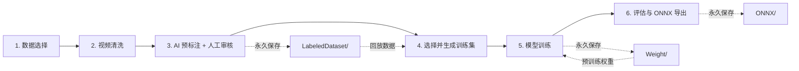
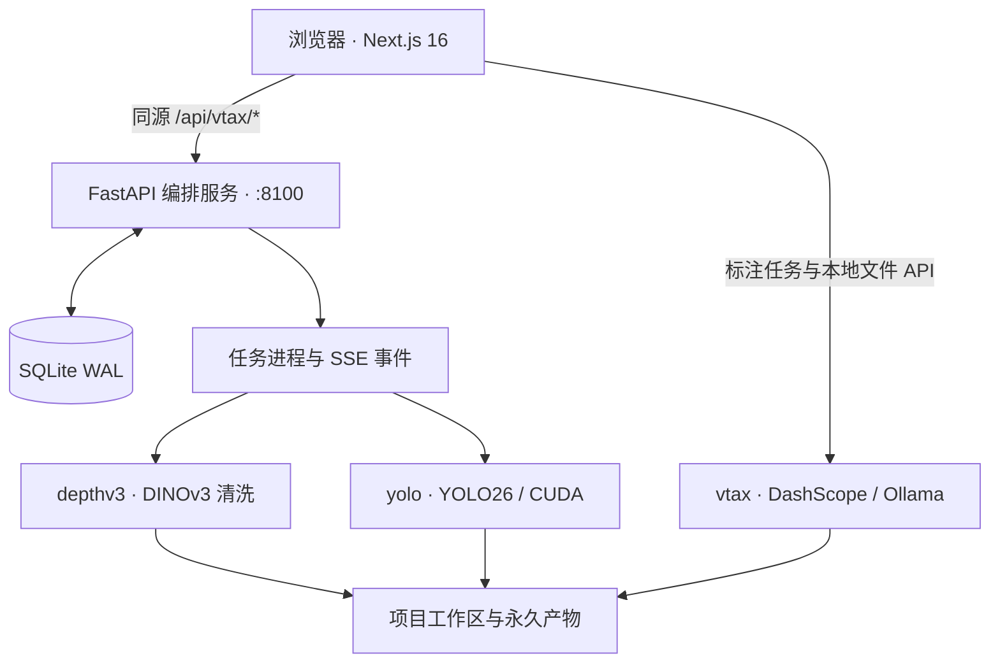

# VTAX · 视频训标一体化系统

<p align="center">
  面向工厂视频目标检测的一站式工作台：从视频选择、清洗、AI 预标注到 YOLO26 训练与 ONNX 导出。
</p>

<p align="center">
  
  
  
  
  
  
</p>

> [!NOTE]
> 当前版本聚焦**目标检测**，面向单机 GPU、单用户或可信局域网环境。首版暂不包含账号权限、多人协同、分割和分类任务。

## 为什么选择 VTAX

传统工厂视觉项目往往需要在多个脚本和工具之间手工搬运数据。VTAX 将完整链路收敛为一个可恢复、可追踪的项目工作区：

- **视频到训练集**：抽帧、质量过滤、DINOv3 去重聚类、代表帧选择和 YOLO 数据集生成。
- **AI 辅助标注**：支持 DashScope API 与本地 Ollama，复用全局类别指南，并在同一页面完成框编辑和人工审核。
- **持续学习**：将本次新数据与历史 `LabeledDataset` 回放数据组合，降低模型遗忘风险。
- **训练可观测**：实时展示 YOLO 训练轮次、Loss、Precision、Recall、mAP 和完整终端日志。
- **产物永久化**：审核数据集、训练权重与 ONNX 模型独立保存在永久目录，删除项目不会误删这些资源。
- **任务可恢复**：SQLite WAL 持久化项目、阶段、任务、事件和产物；支持取消、重试以及从 `last.pt` 恢复训练。

## 工作流



| 阶段 | 输入 | 核心处理 | 主要输出 |
| --- | --- | --- | --- |
| 数据选择 | 一个或多个视频目录 | 预览视频并选择进入清洗的文件 | 只读视频清单 |
| 视频清洗 | 已选视频 | 定时抽帧、质量过滤、DINOv3 去重/聚类 | 代表帧目录与清洗报告 |
| 预标注与审核 | 清洗帧、项目类别 | 大模型框选、人工修订、逐图审核 | LabelMe JSON、永久标注数据集 |
| 选择数据集 | 新数据、0~N 个历史数据集 | 回放抽样、按来源分组、80/15/5 切分 | YOLO 数据集与 `dataset.yaml` |
| 模型训练 | YOLO 数据集、预训练权重 | YOLO26 训练、实时指标与日志 | 永久 `best.pt` / `last.pt` |
| 评估导出 | `best.pt`、test split | 测试集评估、FP32/FP16/INT8 转换 | 永久 ONNX 与指标 |

## 快速开始

### 推荐：Ubuntu 22.04 + systemd

生产式部署使用单机 Ubuntu 22.04、Conda 和 systemd。准备好三个 Conda 环境及模型文件后执行：

```bash
cd /root/WWB/VTAX/Data_Annotation_Agent
cp config_example.json config.json
# 编辑 config.json，配置 DashScope 或 Ollama
bash scripts/install-ubuntu.sh
```

打开：

```text
http://127.0.0.1:3001
```

确认服务健康：

```bash
systemctl status vtax-worker.service vtax-web.service
curl http://127.0.0.1:8100/api/v1/system/health
```

完整的环境准备、模型目录、网络访问、升级和故障排查请阅读 **[部署指南](./DEPLOYMENT.md)**。

### 本地开发

```bash
# Python API 与测试依赖
conda create -n vtax python=3.10 -y
conda run -n vtax python -m pip install -e '.[test]'

# Next.js 前端
npm ci

# 终端 1：编排 API
VTAX_API_PORT=8100 conda run -n vtax python -m data_annotation_agent.vtax.api

# 终端 2：前端开发服务器
VTAX_API_URL=http://127.0.0.1:8100 npm run dev:web -- --hostname 0.0.0.0 --port 3001
```

> [!IMPORTANT]
> 运行视频清洗和模型训练还需要独立的 `depthv3`、`yolo` Conda 环境及本地模型权重。仅启动页面和 API 不代表 GPU 流程已经就绪。

## 系统架构



### 技术栈

- **前端**：Next.js 16、React 19、TypeScript、Tailwind CSS、Radix UI。
- **编排服务**：FastAPI、Pydantic、SQLite WAL、SSE。
- **视频清洗**：FFmpeg/OpenCV、DINOv3、scikit-learn 聚类与去重。
- **预标注**：DashScope 兼容 API 或 Ollama，多类别指南与 LabelMe 格式。
- **训练导出**：本地 Ultralytics YOLO26、PyTorch CUDA、ONNX/ONNX Runtime。

## 数据与目录

默认部署根目录为 `/root/WWB/VTAX`：

```text
/root/WWB/VTAX/
├── Data_Annotation_Agent/       # 本仓库
├── frame_cluster_filter/        # 视频清洗模块
├── workspaces/<project-id>/     # 项目中间过程、任务日志和运行目录
├── LabeledDataset/              # 永久：审核后的 LabelMe 数据集
├── Weight/                      # 永久：best.pt / last.pt
├── ONNX/                        # 永久：导出的 ONNX
├── models/
│   ├── dinov3/vit_l16/          # 本地 DINOv3 模型
│   └── yolo26/                  # yolo26n/s/m/l/x.pt
├── var/vtax.sqlite3             # 项目数据库
├── default_category_guides.json # 所有项目共用的类别指南
└── .env.vtax                    # 服务环境变量，权限 600
```

原始视频只记录只读路径，衍生产物写入 Ubuntu 本地文件系统。`VTAX_ALLOWED_ROOTS` 控制服务可访问的目录边界。

## 类别指南

预标注开始前，VTAX 优先读取全局 `default_category_guides.json`：

- **保存全局默认并开始标注**：修改会永久更新同类别的全局指南，后续项目继续复用。
- **重新调研**：根据当前类别生成仅供本项目使用的指南，不覆盖全局默认值。

指南包含视觉特征、OCR/文字线索、排除规则和歧义说明，用于稳定大模型的标注口径。

## API 概览

编排服务默认监听 `127.0.0.1:8100`，前端通过 `/api/vtax/*` 同源代理访问。

```text
GET/POST  /api/v1/projects
GET/PATCH /api/v1/projects/{id}
DELETE    /api/v1/projects/{id}
POST      /api/v1/projects/{id}/stages/{stage}/import
POST      /api/v1/projects/{id}/stages/{stage}/run
POST      /api/v1/projects/{id}/stages/{stage}/complete
GET       /api/v1/jobs/{id}
POST      /api/v1/jobs/{id}/cancel|retry|resume
GET       /api/v1/jobs/{id}/events
GET       /api/v1/labeled-datasets
GET       /api/v1/weights
GET       /api/v1/system/health
```

## 测试与质量检查

```bash
# Python 核心测试
conda run -n vtax python -m pytest -q

# 前端静态检查与生产构建
npm run lint:web
npm run build:web

# 清洗模块测试
conda run -n depthv3 python -m unittest discover -s ../frame_cluster_filter/tests -v
```

## 安全说明

- `config.json` 和 `/root/WWB/VTAX/.env.vtax` 包含敏感配置，必须设置为 `600`，不要提交到版本库。
- 当前系统没有登录鉴权。默认仅用于本机；暴露到局域网前应增加反向代理、身份认证和 TLS。
- 外部任务通过参数数组启动，不使用 shell 字符串拼接；每个项目同时只运行一个阶段任务，GPU 重任务受全局锁控制。
- 删除项目仅清理项目工作区；`LabeledDataset`、`Weight` 和 `ONNX` 中的永久产物不会随之删除。

## 项目结构

```text
Data_Annotation_Agent/
├── data_annotation_agent/
│   ├── vtax/                    # API、状态机、任务编排、数据集和训练 CLI
│   └── ...                      # 大模型预标注核心
├── web/                         # Next.js 工作台与标注编辑器
├── deploy/                      # systemd 与环境变量模板
├── scripts/                     # Ubuntu 安装脚本
├── tests/                       # Python 单元与集成测试
├── config_example.json          # 模型提供商配置示例
├── DEPLOYMENT.md                # 完整部署指南
└── pyproject.toml
```

## 致谢与设计参考

文档信息架构和产品体验参考了成熟的计算机视觉开源项目：

- [CVAT](https://github.com/cvat-ai/cvat) — 计算机视觉标注工作流。
- [Label Studio](https://github.com/HumanSignal/label-studio) — 数据标注与模型辅助标注。
- [Ultralytics](https://github.com/ultralytics/ultralytics) — YOLO 训练、评估与模型导出。

VTAX 是面向当前工厂视频闭环需求的独立实现；上述项目的名称和商标归各自所有者。
